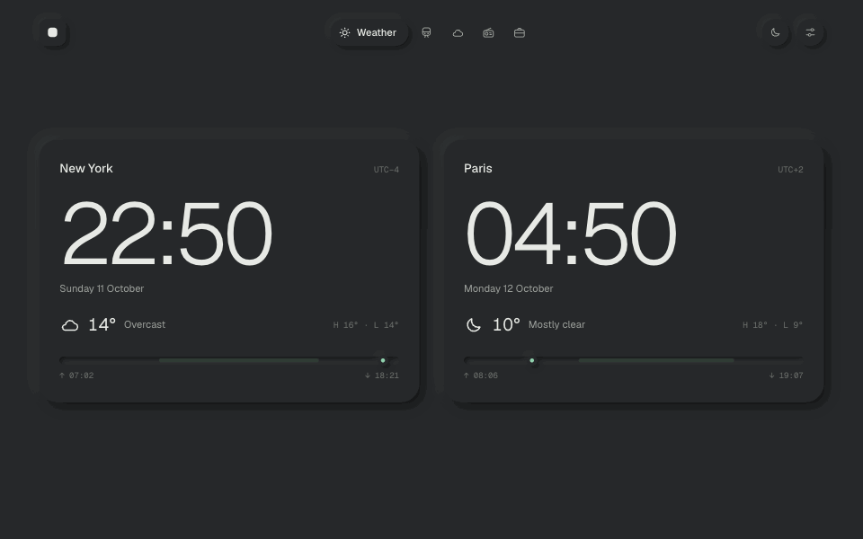
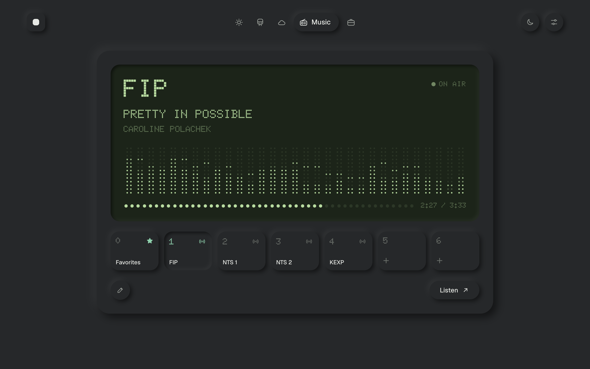
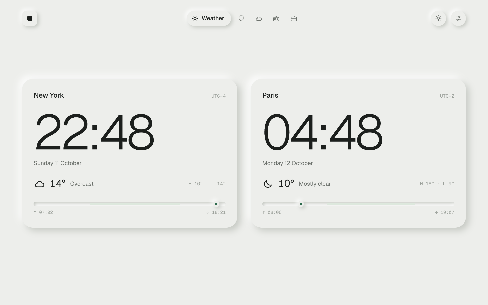
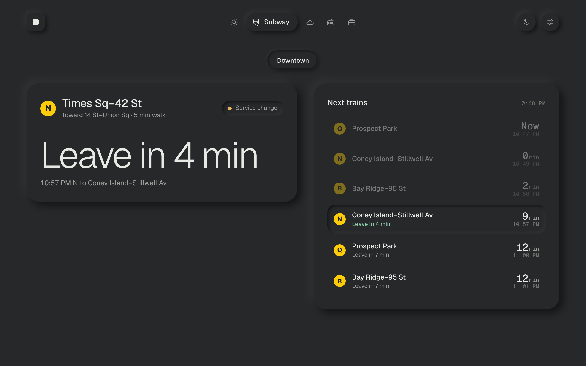
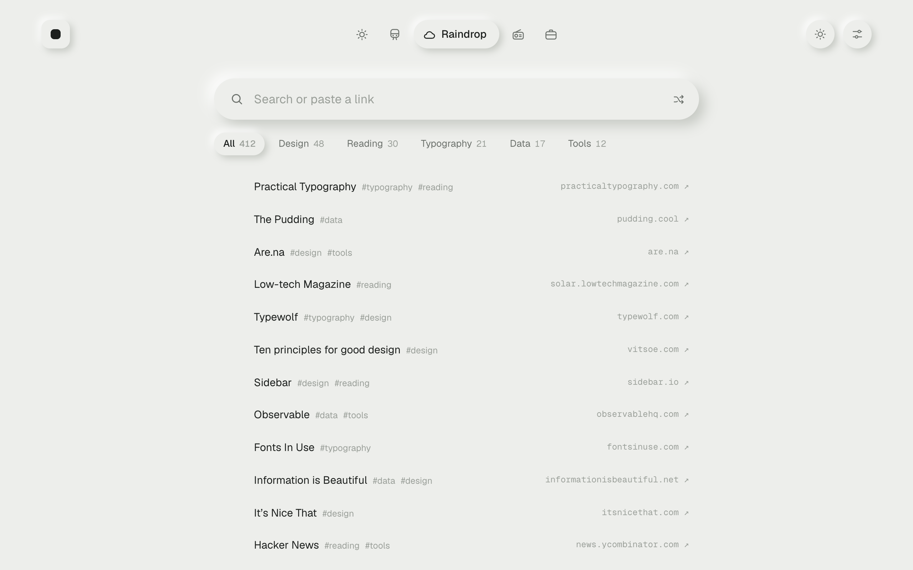
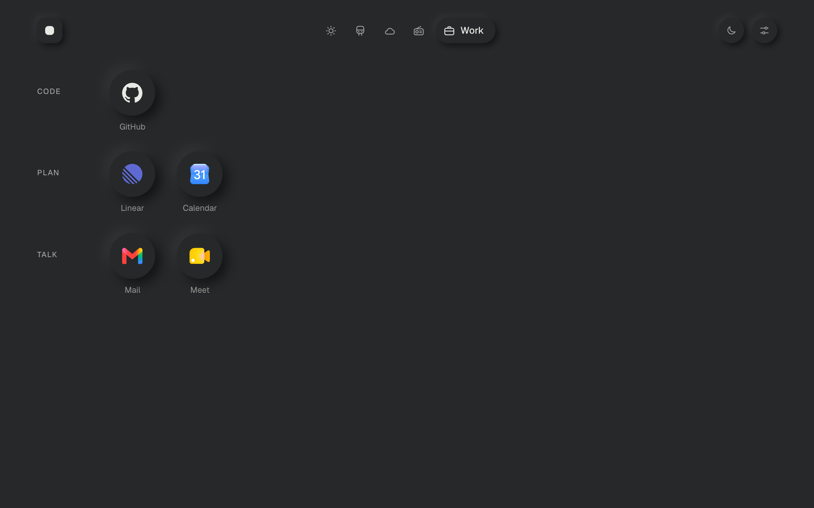
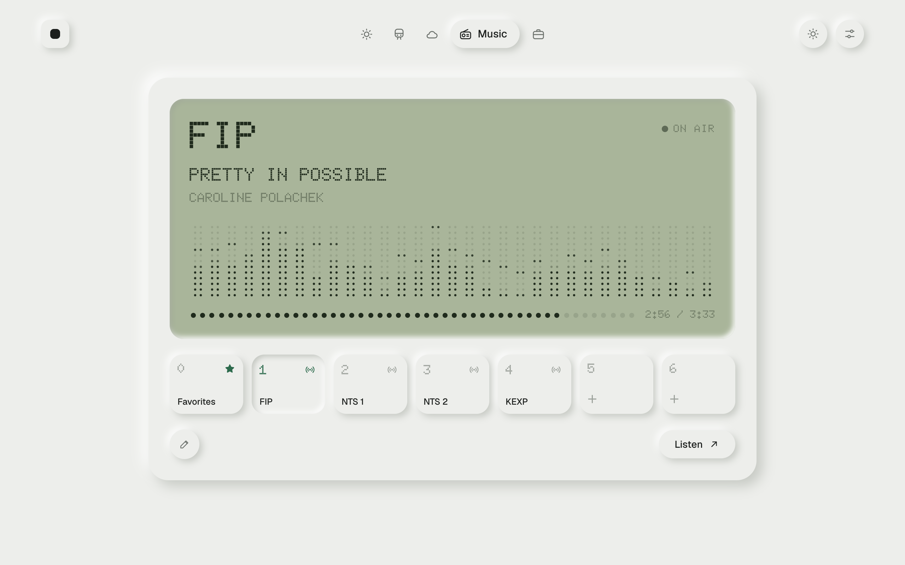

# Softtab

A calm, neumorphic Chrome new tab: weather, NYC subway times, radio and your links.

<p align="center"></p>

| | |
|---|---|
|  |  |
|  |  |
|  |  |

## What's inside

- **Weather**: clocks and live weather for a list of cities.
- **Subway**: next NYC subway departures for saved trips (from/to station, walk time).
- **Raindrop**: search your Raindrop bookmarks; paste a link to save it.
- **Music**: a preset radio that shows what's on air or a channel's latest posts.
- **Link boards**: tabs of quick links grouped by category (Work, plus any you add).

Tabs can be added, renamed, hidden or deleted from Settings → Tabs, and Settings → Backup exports your setup to a file.

## Install

1. Download the latest zip from [Releases](https://github.com/dtsbourg/softtab/releases) and unzip it, or clone this repo.
2. Open `chrome://extensions` and turn on **Developer mode**.
3. Click **Load unpacked** and pick the folder.
4. After changing files, click the reload arrow on the Softtab card.

There is no build step: the extension is plain HTML, CSS and JavaScript.

### Personal defaults

Out of the box Softtab starts with sample content. To start from your own setup instead, create `defaults.local.js` next to `newtab.html` (it is git-ignored):

```js
window.SOFTTAB_LOCAL_DEFAULTS = {
  trips: [{ id: 'downtown', name: 'Downtown', from: 'R16', to: 'R20', walk: 5 }],  // GTFS stop ids from stations.js
  work: [{ g: 'Code', items: [{ n: 'GitHub', u: 'https://github.com' }] }],    // Work board categories
  presets: [/* Music presets */],
  favorites: [/* { t, u, s } */]
};
```

Anything you change in the app is saved in Chrome and takes priority over these defaults.

## Releasing

1. Bump `version` in `manifest.json` and add an entry to [CHANGELOG.md](CHANGELOG.md).
2. Run `scripts/package.sh` to build `dist/softtab-<version>.zip`.
3. Commit, tag `v<version>`, push, and attach the zip to a GitHub release.
4. Upload the same zip to the Chrome Web Store. Listing copy and images are in [`docs/store/`](docs/store/listing.md).

## Files

| File | What it is |
|---|---|
| `manifest.json` | Extension manifest (MV3, overrides the new tab page) |
| `newtab.html`, `styles.css`, `app.js` | The page |
| `theme-init.js` | Applies the saved theme before first paint |
| `gtfs.js` | Minimal GTFS-realtime decoder for the MTA feeds |
| `stations.js` | NYC subway stations, from the MTA's `Stations.csv` |
| `brand-icons.js` | Bundled service logos |
| `fonts/` | Geist, Geist Mono and Doto |

## Data sources

No API keys are needed except a Raindrop test token, which is stored in the browser. Only Open-Meteo is granted at install; the other tabs ask Chrome for access to their service the first time they're used. See the [privacy policy](https://dtsbourg.github.io/softtab/privacy.html).

- Weather and city search: [Open-Meteo](https://open-meteo.com)
- Subway departures and alerts: [MTA GTFS-realtime feeds](https://api.mta.info)
- Station directory for Music presets: [Radio Browser](https://www.radio-browser.info)
- Now playing: Radio France (FIP), NTS, KEXP public APIs
- Latest posts: YouTube and SoundCloud RSS feeds, Mixcloud and NTS APIs
- Bookmarks: [Raindrop.io API](https://developer.raindrop.io)

## Credits

- Fonts: [Geist](https://vercel.com/font) and [Doto](https://fonts.google.com/specimen/Doto), SIL Open Font License.
- Single-colour logos: [Simple Icons](https://simpleicons.org), CC0.
- Full-colour logos: [gilbarbara/logos](https://github.com/gilbarbara/logos) via Iconify, CC0.
